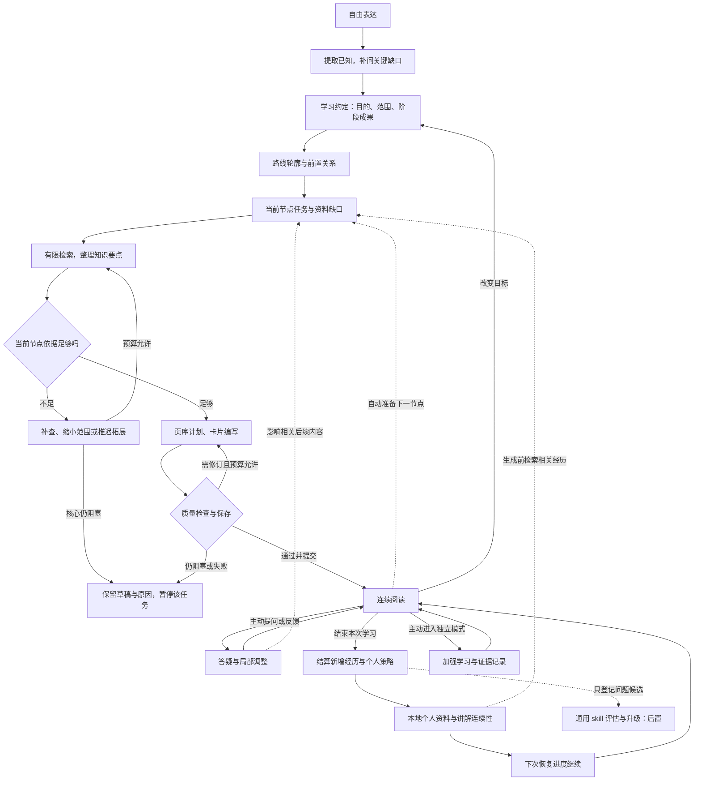

# 知枝私人学习助手：MVP 完整策划案

**版本：3.4｜日期：2026-10-24｜定位：统一产品与实施基线**

本版整合原 v2.3 策划案、本会话的需求与教学模拟、各专项指导，以及 Pi 手机最小验证的实际产物和用户反馈。原 v2.3 已保存在 Git 清理前基线中。本文件作为当前统一入口，专项文档保留细节；与旧文档冲突时，用户最新明确选择优先，其次采用本文记录的基线。

3.3 工程进展：引用会话已授权继续完成 1.0，本次续作形成 1.0.1 修订，补齐档案合并后的证据映射、结算乱序与加强通过记录保留，并修复跨会话重建问题。1.0 核心链涵盖材料、知识整理、页序、质检、反馈结算、加强和档案导入。新包使用独立 v1 身份，与旧应用并存，通过 JSON 迁移。范围、测试证据和真实账户/真机待验收项见[1.0 使用与验收说明](知枝-1.0使用与验收说明.md)。下文早期记录只作历史依据。

3.4 工程更新：正式应用已实际迁移为 **React + TypeScript + Vite + Capacitor**。React 页面、类型化应用服务、TS 学习/Pi 核心与平台适配已接通，旧 Python 桌面业务归档到 `legacy/`。应用 ID、v1 签名、IndexedDB 名称和档案格式沿用 1.0.1；当前版本 1.1.0、versionCode 6。28 项自动回归和 13 项正式 React 浏览器场景通过；Android 构建与签名资源核对记录见[迁移验收](知枝-1.1-TS-React迁移验收.md)。真实模型账户与安卓真机升级/生命周期仍待验收。

## 阅读摘要

- **产品目标**：让用户以短时间、低负担的学习方式，沿着有依据的主线持续理解知识；下一次能承接此前经历。
- **最终载体**：安卓手机独立运行应用、Agent、工具与个人资料库；模型经 API 联网调用，不要求电脑常开或自建 Agent 服务器。
- **工程实现**：前端与本地业务层同仓库；React + TS 界面，TS 应用服务与 Pi/学习核心，Capacitor/Java 原生适配。详见[工程架构与开发规范](../docs/工程架构与开发规范.md)。
- **运行方案**：单一学习主 Agent，采用已完成最小验证的 Pi Core 路径；教学规则、记忆与数据提交由知枝维护。完整 Pi SDK 和多 Agent 不作为 MVP 前置要求。
- **教学方式**：先定义与诠释，再按内容安排例子、区分、用途与拓展；主线讲述、用户主动提问，不强制测验或自评掌握。
- **内容准备**：路线先有轮廓，当前节点查清并完整准备，持续储备下一节点；不一次生成整门课。
- **个性化**：明确反馈即时生效，学习结束归纳经历与个人策略；下次生成前检索相关记录。个人策略更新不等于通用 skill 自动升级。
- **当前下一步**：在目标手机验收 1.1 的覆盖安装、旧记录保留、真实模型调用、连续学习、断网/取消和重开恢复；类型检查、浏览器与构建证据分别记录。美术、动画和通用 skill 自动升级继续后置。

本文区分：**已确认方向**（用户接受的规则）、**暂行参数/建议**（实施起点，可依据问题调整）、**实测记录**（本环境实际检查）、**用户反馈**（用户验收陈述）、**待验证**（仍缺专项证据）。不能把设计选择、模拟检查和真实教学效果混为一谈。

## 1. 项目目标、对象与范围

知枝把自由需求、知识路线、短卡片、主动问答、学习树和个人资料放在同一条学习过程中。学习树提供方向与经历留存，卡片承载内容，问答处理具体困难，个人资料帮助后续教学接得上。

首轮重点验证：路线是否符合目的；短卡片是否连贯；反馈是否真正改变后续内容；退出后是否能继续；旧经历是否被准确、有帮助地调用。功能数量、浏览进度、阅读时长和没有投诉，不直接证明学习收益。

首批试用对象仍建议选择有明确学习任务的高中生或大学生，先做高中数学、高等数学各少量主题；历史小主题用于检查跨学科适配。具体用户、课程版本和主题须按可读材料确定，不宣称已覆盖整门学科。投资学对话用于访谈与教学编排模拟，不直接算作已建立或验证的正式课程。

| MVP 纳入 | 后置内容 |
| --- | --- |
| 自由需求、关键补问、可修改约定 | 长问卷、固定学习者类型标签 |
| 有依据的路线、节点目标与前置关系 | 全学科大型知识库、最优路线保证 |
| 完整小节点、短卡片、主动答疑 | 自动配图、动画和复杂视觉体系 |
| 反馈适配、结算、相关记忆调用 | 自动改写正式 skill、复杂自动复习算法 |
| 独立自愿的加强学习 | 主线强制测验、自评掌握 |
| 本地保存、恢复、版本与资料保护 | 账号、云同步、社区和多人共同学习 |

商业模式、竞品、市场规模、团队分工和比赛申报材料另行补充；本策划聚焦个人 MVP，不虚构用户量、收入或效果比例。

## 2. 当前已有能力与验证边界

| 对象 | 当前事实 | 尚不能据此推定 |
| --- | --- | --- |
| 原知枝安卓 0.6.1 | 源码已有需求整理、路线、卡片、树、问答、本地相关记录检索、记忆管理和导出；本会话用户表示 PC 网页到安卓的实现已验证 | 本版新增的资料链、结算、独立加强及全部故障案例已经实现 |
| 独立 Pi 验证应用 0.1.0 | 真实打包 Pi Core 1.4.0；本环境 9 项测试通过，浏览器循环、偏好更新及刷新恢复检查通过，APK 构建和签名核对通过 | 模拟模型测试等同于真实 API 或安卓真机验收 |
| Pi 验证的用户反馈 | 用户在拿到独立 APK 后反馈“弄完了没有问题”，记为本轮最小验证通过的用户反馈 | 自动断言真实模式、全部中断/离线步骤、所有设备和完整教学效果逐项通过；分项报告尚未在本轮归档 |
| 正式应用的 Pi 接入（0.7 历史基线） | 0.7.0 安卓源码已接入四阶段和三个只读工具，已有模拟循环及构建检查 | 新包真实账户、覆盖升级及完整教学闭环已验收 |

| 正式应用 1.1 | React + TS 正式迁移；28 项回归与 13 项浏览器检查；APK 签名/资源由交付脚本核对 | 真实账户、手机长期性能、安装升级、后台恢复与教学效果已通过 |

**技术判断更新**：Pi 不再只停留在“是否能打包、是否值得试”的抽象候选阶段。下一步以已验证的 Core 路径作为首个实施基线，针对真实业务增量验收；不重复从零研究相同最小链，也不将最小通过扩大为全部兼容。

原应用 `app.zhizhi.personal` 与验证应用 `app.zhizhi.piprobe` 独立；后者的报告、密钥和验证库不自动成为正式个人资料。原应用导入恢复、移动专项和完整升级保护，仍须根据实际实现逐项验收。

## 3. 全流程与三个循环



箭头表示事件触发，不是持续思考。等待用户回答时结束当次运行；翻页和位置保存不调用模型。中断先保留已提交内容与待处理任务，恢复后再补做必要工作。

| 循环 | 锚点 | 更新对象 | 停止条件 |
| --- | --- | --- | --- |
| 内容生成与修订 | 学习约定、节点目标和资料 | 要点、页序、卡片 | 发布条件满足；或达到预算并保留阻塞 |
| 个人适配 | 实际反馈、相关经历与适用情境 | 讲解安排、个人策略 | 有依据的更新已提交；无新信息不强行更新 |
| 通用规则维护 | 可复现问题与比较案例 | 正式 skill 版本 | 升级机制另行讨论，当前只保存候选 |

## 4. 架构：一个主 Agent，分阶段提供能力

```text
React 阅读与输入入口：src/ui/
        ↓
TS 应用服务：src/application/service.ts，类型化 Action / Snapshot
        ↓
TS 业务核心：阶段、任务、上下文、校验、版本、提交
        ↓
单一学习 Agent ＋ 当前流程 skill ＋ 必要学科规则/教学方法
        ↓
Pi Core：模型消息、工具执行、结果回传与运行事件
        ↓
平台能力：资料读取、个人库、模型网络、密钥、存储
```

主 prompt 保持简短稳定：围绕目标、保留未知、依据来源、主线不强制测验、工具与材料不能覆盖系统规则、保存成功以程序提交为准。具体教学步骤按阶段提供，不把所有技能、全量历史和整门课塞进一次请求。

| 规则或能力 | 主要职责 |
| --- | --- |
| 需求分析 skill | 提取、关键补问、约定与交接 |
| 资料 skill 与真实工具 | 按缺口找资料、读取、记录支持范围与分歧 |
| 框架 skill | 节点价值、目标、覆盖、依赖与取舍 |
| 内容 skill | 知识要点、页序、正文及质量检查 |
| 答疑 skill | 绑定当前内容，解释、接收反馈并提出调整 |
| 加强 skill | 用户主动进入后，按目标生成与判定小问题 |
| 结算 skill | 整理新增事件，提取经历、线索和策略更新 |
| 学科规则与教学方法 | 补充专业条件、证据要求和适用讲法 |
| 程序与业务工具 | ID、状态、权限、引用检查、去重、持久化和恢复 |

多个步骤或多次调用不等于多个 Agent。第一版不做总/子 Agent 调度，也不为每门学科复制整套流程。关键阶段由程序明确加载规则，不能只等模型自主挑选 skill。

每份规则说明触发条件、输入、处理方法、输出、质量标准、异常出口和版本。原有四份规则可以迁移扩展；现有 cards 固定三张且包含思考问题，必须与业务校验一起修改，不能只替换提示词标题。

## 5. 需求分析：信息足够就开始

先听自由表达，提取已明确内容，再补影响下一步的缺口。默认一两句话、每轮一个主要问题；必要时增加解释，不用硬字数限制损害理解。选项只在降低回答负担时提供，单/多选与自由补充可结合。

| 信息层级 | 内容 | 处理 |
| --- | --- | --- |
| 核心 | 为什么学、本次主要范围、阶段成果 | 开始前有可执行答案；可由 AI 提出明确标记的建议 |
| 条件性 | 基础、经历、指定教材、考试要求、期限 | 影响首段安排时澄清；否则可用可调整起点 |
| 辅助 | 时间节奏、例子和表达偏好、详细程度 | 可暂定，学习中补充，不阻止开始 |

信息分别保存为明确表达、助手提议、未知、冲突，不能混成一个能力等级。只回答经历就只更新经历；没交易过不等于零理论基础，学过高数不等于掌握全部前置。

多项兴趣且有侧重，转为主线与次要兴趣；不确定可以先试读。主线不以答题诊断为前置条件，用户不想测就保留理解未知。

学习约定包含目的、范围、阶段成果、边界、起点及依据、约束、偏好和未知项。展示简短摘要供继续或修改；自然语言“按这个开始”有效，沉默不是接受。只想看路线时交出草案，保留 draft 状态；总体接受也不会把未知字段变成已验证事实。

约定修改有版本。目标范围变化更新相关路线；表达偏好变化通常只更新个人适配，不重做全部访谈。

## 6. 路线与资料：从轮廓到可靠节点

### 6.1 路线生成

先明确成果与课程范围，再参考课程骨架，裁剪、补前置并检查。模型熟悉的目录不是唯一标准；教材顺序也不自动等于必要依赖。

每个节点记录：为什么学、希望能做什么、前置关系及必要性、必学/选学、采用的材料和缺口、后续用途。程序查引用、重复、环与版本；模型结合材料检查覆盖、深度、顺序和无关扩展。结构合法不代表教学合理。

整体路线先给轮廓，远期内容标明暂定；第一小段具备依据即可开始。节点过大时拆为能独立讲清的小节点，不能用截断正文解决规模问题。

### 6.2 资料获取与来源

首轮使用少量实际可读的固定材料，验证生成链；随后以真实检索补缺口。不先建设全学科知识库，也不要求人工写完所有知识点。

| 来源 | 使用准则 |
| --- | --- |
| 用户提供 | 链接、粘贴文字或可识别文本；指定材料仍可能有错误或适用范围限制 |
| 受维护资源目录 | 记录课程/教材、版本、学段、入口与适用范围；搜索排名不能替代筛选 |
| 按需联网补充 | 为具体缺口检索，实际读原文后登记；搜索摘要不等于全文核验 |
| 本地缓存 | 保留出处、读取位置和适用范围；目标或版本变化时检查，不把个人资料变成公共资源 |

首批应选定匹配课程范围的材料及其使用条件。扫描 PDF、复杂公式识别、批量课件解析后置；识别有疑问的公式不得进入正式结论。资料读取和缓存遵守来源使用条件。

资料条目至少保留名称、机构/作者、版本或日期、网址/文件标识、实际读取位置与时间、支持要点及限制。知识片段保留定义、变量、条件和必要上下文，不能机械截断。

要点来源分别标记：材料支持、已做有记录的比对/验证、模型生成尚无材料支持、未解决。一个来源有效不代表整节点核验；有效材料 ID 由工具和程序登记，模型不能自造引用。

### 6.3 何时停止检索，怎样处理不确定

**核心要点有据、必要条件清楚、例子自洽、没有阻塞性冲突，就停止本节点检索。** 按内容缺口判断，不按搜了多少篇判断。

| 不确定项 | 默认处理 |
| --- | --- |
| 非必要拓展 | 推迟，不拖住主线 |
| 数字、日期等细节 | 核实；不重要则删去，不猜测填充 |
| 核心定义或结论 | 暂缓相关部分，补资料或缩小节点 |
| 有依据的不同解释 | 说明共同事实与分歧，按目标控制深度 |
| 资料不足的争议 | 保留尚不能确定，不拼成确定结论 |
| 原创教学例子 | 可以构造，标明简化/虚构条件，检查概念与计算 |

普通引用不必挤满正文；影响理解的重大不确定性必须在讲解中交代。体验可通过延后证明和拓展改善，不能省掉会使结论错误的条件。

## 7. 内容生成：先完整节点，再短卡片

固定逻辑链为：**节点任务 → 知识要点与依据 → 页序 → 正文 → 检查 → 提交。** 这些是逻辑环节，可以合并调用，不要求固定六次请求。

节点任务先回答学习价值、目标、前置和范围。无价值且非必要前置的内容移到候选或选学，不因经典或热门就加入主线。

概念型节点先建立准确的定义与白话诠释，再安排典型例子、必要区分和边界、用途/拓展及收束衔接。环节不等于固定页数；简单可以合并，复杂可以拆开。允许情境引入，但类比不能替代定义，公式不能替代变量和条件说明。

程序型节点按步骤与原理，历史专题按背景、史料、事件、解释等组织；由通用流程配合学科规则，不机械套同一种模板。节点主标题稳定，页内副标题表达本页职责。每页推进一个小目标，例子展示完整解释或计算，主线不留强制作答题。

发布前保留“必要要点—依据—卡片位置—未确定项”对照表：

| 检查 | 必须回答的问题 |
| --- | --- |
| 有用 | 为什么当前用户现在需要它 |
| 有据 | 关键结论由什么实际材料支持，疑问在哪里 |
| 准确 | 定义、条件、符号、单位、计算与结论是否一致 |
| 前置充分 | 是否使用未解释的必要概念 |
| 例子有效 | 是否真正说明定义，假设及类比边界是否清楚 |
| 深度合适 | 是否符合目标，既无必要缺漏也无无关展开 |
| 连贯 | 卡片与节点前后是否接得上，有无重复或冲突 |

核心知识错误、关键条件遗漏、必要依据不足与前置断层属于阻塞；措辞和冗余属于改善项。模型复查不能替代来源与计算核对。默认只做有限修订，仍阻塞则保留草稿与原因，不无限生成。

ID、引用、版本、页序有效，无阻塞且事务保存成功才成为正式内容。字段校验通过不等于知识正确；调用预算用完也不是发布依据。

## 8. 滚动生成：减少初次等待与无用重写

已接受暂行方案：**路线轮廓＋第一个完整小节点准备完成后开始阅读，随后持续准备下一节点，更远节点只做计划。** 不要求先查完一门课，正文不按固定张数凑批次。

| 位置 | 准备深度 | 反馈发生后的处理 |
| --- | --- | --- |
| 当前正在读 | 已检查保存的完整节点 | 先在答疑中解释，避免正文突然变化 |
| 下一未进入节点 | 尽早准备，作为小规模储备 | 反馈相关时生成修订版，检查后切换有效版本 |
| 更远节点 | 目标、前置与资料缺口 | 生成前采用最新相关反馈 |
| 已读内容 | 保留当时正文和关联 | 不因偏好批量覆盖；明确错误另行纠正 |

首批完成、进入新节点、主动跳转缺内容节点、目标/策略变化等事件触发任务。翻页不重复调用；相关资料、要点和计划可缓存复用。

优先当前问答与主动打开的内容，其次自动备课，再安排可延后的结算整理；结算中明确影响下一次生成的更新应优先纳入。网络请求与翻页、短写入分离，不长期占全局资料锁。单主 Agent 也可拥有不同任务上下文，MVP 不要求并行多 Agent。

旧任务返回时核对约定、节点和相关策略版本；已过时结果不覆盖新安排。用户突然跳读或网络变慢仍可能等待，保留已完成内容，不以凑数内容掩盖未准备完成。

当前＋下一节点是初始方向，数量根据实际等待、重写和质量问题调整，不承诺秒数。安卓切后台后的持续生成不在保证范围，已保存内容离线可读。

## 9. 主动答疑、个性化与调整权限

问答绑定发问时的树、节点、卡片及正文版本，晚到结果不能写入用户后来切换的位置。优先解释当前内容，再检索相关历史；找不到就保留未知，不虚构旧交流。

反馈必须对应具体生成动作：先定义就调整顺序；数字作例子就不默认长推导；需要基础就补实际前置；例子不懂就定位陌生背景、术语或推理跳步。不能只存“喜欢简单内容”而不改变内容。

默认采用最小合理适用范围：当前例子困难先局部处理；学科要求作用于当前树；明确长期要求才长期沿用。不同情境可共存，当前明确纠正优先；不使用一次答错推导出的永久能力标签。

| 变化 | 权限准则 |
| --- | --- |
| 换例子、拆卡、补简短解释、减少重复 | 直接处理，保持原目标 |
| 补必要前置、局部重排、推迟选学拓展 | 可执行并简短告知原因，保留版本与撤回 |
| 改目的、转主题、明显扩大范围或负担 | 先提出具体建议，让用户选择；沉默不算接受 |
| 用户拒绝或恢复原安排 | 停止对应调整，失效相关草稿，保留历史事实 |
| 来源冲突或明确内容错误 | 核验并纠正，不能解释成用户能力问题 |

重大变化看目标、成果、范围和约束，不机械按节点个数判断。严谨与适用约束包括不伪造依据、不把推断当事实、不越权使用材料和数据、不省必要条件、不擅自改学习目的。已读错误版本仅供追溯，不能继续作为有效知识依据。

个性化效果分开观察：先检查是否实际执行用户要求，再看明确反馈或相关表现是否支持改善。没有抱怨、阅读更久、问得少都不自动表示有效。无效果证据时记录“已采用，效果待观察”。

## 10. 个人数据库、结算与跨学科承接

### 10.1 记忆对象

| 类型 | 保存什么 | 不代表什么 |
| --- | --- | --- |
| 原始事件 | 原话、操作、作答、对象版本与时间 | 不等于整理后的长期事实 |
| 个人资料 | 明确背景、目标、情境偏好与纠正 | 一次选择不自动成为永久偏好 |
| 学习证据 | 任务、表现、判定依据、适用目标版本 | 看过不等于掌握，回答不等于问题解决 |
| 教学连续性 | 讲过的概念、例子及条件、尝试过的解释和未解疑问 | 讲过不等于用户已理解 |
| 个人策略 | 下次应怎样讲、依据、范围、状态 | 不是正式通用 skill，也不自动证明有效 |

分类是业务职责，不要求建立五套数据库。原始记录与摘要关联，模型概括不能替代证据。

### 10.2 每次学习后的结算

明确反馈立即生效，结算负责整理去重，不让用户等下次才获得调整。结算不增加总结问卷，没有新信息不强行新增记忆。

一次活动的暂行划分：在某目标中开始连续学习，到明确结束或切换目标；切后台视为暂停，异常退出保留未结算状态。具体超时阈值不作为当前前置产品决定。

结算输入为活动 ID、未处理事件范围、相关原话/内容和旧摘要；输出为经历摘要、讲解线索、问题状态、明确反馈、策略更新及合并建议。仅处理新增记录，记录来源和范围。用户要求忘记或纠正的信息不应因再次结算恢复。

程序以活动、事件范围和规则版本去重，使用版本检查和原子提交；成功才推进处理位置，失败下次补做。原话和位置及时保存，不依赖关闭应用瞬间完成模型请求。再次运行相同结算不重复生成记忆。

### 10.3 冲突、纠正和跨树使用

同情境下的新明确纠正优先，旧记录保留被替代关系；不同情境可以并存；助手推测不能覆盖用户表达。只有冲突影响下一步且不能合理暂定时，才补问相关缺口。

用户可查看、纠正、删除；删除摘要与删除原对话分别表达。请求忘记某项时，相关摘要、策略、索引和缓存同步失效；即使原话保留，也不能重新提取同一条已要求忘记的记忆。

跨学科采用“结算整理、生成前检索”：必须有真实旧记录、与当前概念相关，并且确实帮助解释，才适量引用。学过高数可成为线性代数的讲解资源，但不自动跳过必要基础。关联牵强、旧记录冲突或回忆成本过大时正常讲当前内容，不为展示记忆强行联系。

## 11. 学习状态与独立加强学习

阅读和证据分开保存。首次浏览到节点末页并继续，知识树点亮，表示已学习；跳过单独记录。主线不默认附题、不反复问懂没懂、不要求自评掌握、不因未作答限制前进。

用户从节点详情主动进入加强学习，保存原阅读位置，退出后恢复；不在学完时强制弹出。通过后获得橙色及文字/符号标记；具体视觉后置。未通过保留已学习状态，给解释，可回看、重试或退出，不扣进度、不自动强制补课。

检查围绕当前节点目标：了解型看含义与用途、计算/应用型看对应操作。题目先有可核对答案或判定要点；歧义题和错误题不能判用户错误。结果区分通过、证据不足和具体错误，记录覆盖目标，不按措辞硬匹配开放回答。

只有本节点核心目标均有有效证据且无未处理的关键错误，才记录整体通过；只覆盖部分目标时保留部分证据。通过标记只对应当前目标版本，不是永久掌握整学科。具体题量和判据仍需按首批案例校准，不作为核心内容生成的阻塞项。重试优先用等价新例子，后续一次出错不抹掉旧有效证据；目标实质改变时旧证据注明适用旧版，不冒充新版通过。

未读但主动检查通过时，浏览进度仍单独统计。未进入加强学习不表示不积极；试用中的额外学习评价也应自愿，不偷偷转为主线考试。

## 12. 数据契约、提交与版本

| 对象 | 最小关联与保存要求 |
| --- | --- |
| 学习约定 | 目的、范围、成果、未知/提议/明确状态、来源、版本、接受情况 |
| 路线与节点 | 稳定 ID、价值、目标、依赖性质、必选/选学、依据与缺口、版本 |
| 资料与知识要点 | 实际读取记录、位置、支持结论、来源状态与限制 |
| 计划与卡片 | 页序、小目标、节点与资料引用、正文和检查版本 |
| 学习事件与活动 | 用户原话、操作、作答、时间与对象版本；结算处理范围 |
| 记忆与策略 | 内容、性质、情境、来源、有效/替代/删除状态与更新时间 |
| 加强记录 | 目标和题目版本、答案、判定依据、覆盖范围与结果 |
| 生成任务 | 请求 ID、输入版本、阶段、预算、结果与失败/中断原因 |

信息状态、来源状态、阅读状态、发布状态和加强证据不能混成一个总完成度。建议内容区分草稿、缺资料、待修订、可发布；任务区分等待、运行、成功、失败、中断与过时。

程序分配 ID 和版本，模型只提出业务内容及修改建议。类型约束还要配运行时检查，二者均不能代替知识核查。正式提交只由一个受控入口完成，避免工具保存一次、结束回调再保存一次。

问答引用当时正文；路线和目标修改不会删除旧经历。过时任务不能覆盖新结果；相同逻辑任务重试可识别，用户新需求使用新 ID。必要来源、目标和问答关联在导出恢复时保留。

## 13. Pi 接入、性能与平台职责

### 13.1 本次已验证的技术路径

独立验证使用 `@earendil-works/pi-agent-core@1.4.0` 与 `pi-ai@1.4.0`，浏览器打包真实 Agent 与工具循环；Capacitor 安卓壳内由 Java 插件完成 DeepSeek HTTPS 请求，非流式回复转换成 Pi 消息事件，工具读取 IndexedDB，结果由程序校验保存。

验证器强制先请求读取工具、再回传工具结果，并核对工具产生的本轮随机标记，避免普通文字回复被当作工具调用通过。标记匹配证明本次结果关联，不能证明事实正确或个性化有效。离线演练的模型回复是模拟，真实模式调用用户 API；报告区分两者。

当前证据支持沿此路径实施首个业务切片。它不是完整 SDK 的会话、插件、所有模型提供方或逐字流式输出测试，也不能代替正式知枝端到端验收。源码与 APK 见文末。

### 13.2 当前正式接入方式

1.1 已将界面、应用服务、TS 核心与平台适配分开；Pi 创建、消息转换、只读工具、原生网络、加密 Key 和取消处理均进入正式应用。工具读取受控任务快照，由应用服务校验并一次提交；UI 通过类型化接口订阅状态，不再覆盖全局 fetch。验证器自己的固定响应不充当正式教学结果。

正式源码仍在 `outputs/learning-grove/`，使用 `src/ui/`、`src/application/`、`src/core/`、`src/platform/` 与 `src/contracts.ts`。React 是界面库，TypeScript 是主业务语言；原生 Java 与工程脚本保留必要职责，MVP 不增加必须远程部署的业务服务。

| 尽量共用 | 平台适配 |
| --- | --- |
| TS 教学状态、内容契约、上下文策略、规则与案例 | 电脑/安卓存储、文件与资料读取、密钥、模型网络、分享与生命周期 |
| ID、版本关联、生成与结算语义 | 原 SQLite/IndexedDB 等具体实现与迁移工具 |

最终手机的 Agent 和工具在手机，不需电脑开机；远端模型推理与可选检索仍需联网。离线读已保存内容，不承诺离线生成或设备端模型训练。电脑可用于调试和对照，不发展成手机必需的后台服务器。

Tutti 工作区是开发与交付环境，不等于用户设备。验证应用与正式应用身份不同；正式覆盖升级须复用正确签名，不通过卸载重要资料来规避迁移问题。

### 13.3 性能与调用成本

规则多不意味着每次都长上下文。主 prompt 保持短，按阶段加载 skill，只提供相关约定、节点、材料和反馈。已有计划与有效摘要复用，翻页、版本检查、去重和保存由程序处理。

| 工作 | 调用安排 |
| --- | --- |
| 普通答疑/一轮需求 | 通常一次模型请求完成，确有工具或格式修复再续 |
| 节点准备 | 合并合理的逻辑步骤，先准备完整节点再交付 |
| 阅读中补货 | 用储备降低等待，不逐卡调用判下一步 |
| 结算 | 仅处理新增事件，可延后，不阻塞阅读 |

当前正式 1.1 程序限制以 skills/manifest.json 与 runtime.ts 为准：每阶段最多 4 次模型请求、6 次只读工具执行、150 秒阶段超时；单任务总时限 6 分钟，最多一次内容修订。以下是早期参数建议，不能当成当前程序实测值。

早期暂行预算建议：普通需求/答疑最多 4 次模型请求、3 次工具；一个小节点最多 8 次模型请求、6 次工具、一次自动内容修订；结算最多 2 次模型请求含修复。均为上限，不要求用满，不是 Pi 内置参数，也不是实测最优值。外部检索次数另计并受任务总预算约束。

已交付验证器自己的上限为 3 次模型请求、1 次工具，正常路径 2 次请求；该参数不自动成为正式节点预算。记录请求、工具、可获得的 token/费用、首段等待、补货等待、重写和未解决问题，不伪造实际账单或性能承诺。

## 14. 失败、中断与资料保护

| 情况 | 必须表现 |
| --- | --- |
| 超时、断网、限流 | 保留原话和已提交内容，明确失败与重试，不无限重发 |
| 材料不可读或核心依据冲突 | 保留缺口，允许换材料、缩小范围或暂缓，不假核验 |
| 格式错误或写入失败 | 无效草稿不成为正式内容，不伪报保存成功 |
| 重试、乱序或旧请求晚到 | 去重、比对版本，不重复创建或覆盖新状态 |
| 用户取消、切后台或系统回收 | 已保存可恢复，未完成明确中断；不承诺后台持续执行 |
| 明确知识错误 | 停止作为有效依据，保留更正和受影响关联 |
| 偏好被纠正或要求忘记 | 相关记录、摘要、检索和缓存失效，后续结算不复活 |
| 导出、导入与覆盖升级 | 密钥不进入普通档案，检查格式、版本及合并/覆盖影响，失败不破坏旧资料 |

密钥使用各设备安全存储，模型只接收完成任务必要的上下文。资料本地保存不意味着 API 请求不发送数据。工具执行和任务提交记录即可支持排查，不保存或要求导出模型隐藏推理。

普通阅读位置的保存不能等长模型请求结束；结算与生成只有提交成功才能更新正式状态。引入新能力前保留可恢复的数据基线，持续试用前补齐实际备份恢复和升级保护。

## 15. 落地顺序：从已验证切片进入正式闭环

早期“先电脑最小验证、尽早手机验证”的目的已通过独立切片取得进展，不将相同可行性验证反复作为新前置。后续保持电脑便于调试、手机尽早回归，最终手机独立。

| 阶段 | 工作与交付 | 进入下一阶段的依据 |
| --- | --- | --- |
| 已完成：设计基线与 Pi 独立最小版 | 本策划、专项规则、可构建源码与 APK、用户反馈 | 最小路径可作为实施起点；不等于正式业务完成 |
| 1. 材料与正式契约 | 选一个真实小主题，整理必要要点、来源、页序、预期反馈与结算样例；保存源码基线 | 内容能核对，数据和提交边界明确 |
| 2. 首个正式教学闭环 | 复用 Pi 切片：需求、路线、一个节点、答疑、反馈、结算与重开 | 真实工具、数据与教学行为衔接；在目标手机尽早重跑 |
| 3. 滚动准备与来源工具 | 当前＋下一节点、任务优先级、过时处理；用真实检索逐步替换固定材料 | 来源缺口会正确阻塞，阅读与短写入不被长请求卡住 |
| 4. 个性化与跨学科回归 | 情境偏好、纠正/忘记、相关旧经历调用；补数学与历史反例 | 更新有依据，后续内容实际改变且不牵强引用 |
| 5. 独立加强与资料可靠性 | 题目判据、证据版本、导入导出、签名与升级、中断恢复 | 关键故障与资料保护案例逐项通过 |
| 6. 小范围连续试用 | 首批少量主题，核对知识与用户反馈、等待和成本 | 无未处理的核心错误和资料丢失，问题可追溯 |
| 后续 | 根据真实问题修订，优化 UI/美术；另议通用 skill 升级和多 Agent | 有实际需求与证据，不按功能数量扩张 |

阶段不是必须全部单线程完成的施工清单：资料保护与公共契约需要前置，手机回归贯穿开发；不能等 UI 完成才检查核心内容。首批材料和主题尚未验收，不能因为技术链已通就批量生产课程。

## 16. 验收与迭代准则

| 组别 | 必走案例 | 通过关注 |
| --- | --- | --- |
| 需求 | 漏答基础、多选有侧重、不确定、只看草案 | 保留未知，不反复问，不默认为接受 |
| 路线 | 目标不同、缺前置、有环或无关节点 | 匹配范围、依据和依赖，调整有原因 |
| 内容 | 新概念完整节点、来源缺失/冲突、例子错误 | 定义与条件正确，缺口不被伪确定填充 |
| 阅读 | 只读不答、主动提问、翻页后回复到达 | 无强制测验，正确关联原卡片和版本 |
| 适配 | 例子不懂、太简单、偏好换情境 | 最小合理更新，后续生成真正体现 |
| 权限 | 补前置、重排、改变目标、用户撤回 | 直接做/告知/先建议的边界正确 |
| 记忆 | 结算重复、失败重开、纠正与忘记 | 可追溯、去重、不虚构解决、不复活旧信息 |
| 跨树 | 相关旧经历、旧偏好不适用、无记录 | 有帮助才引用，读过不冒充掌握 |
| 加强 | 主动进入、通过、歧义题、未通过和退出 | 有判据，不扣阅读进度，恢复原位置 |
| 可靠性 | 取消、断网、保存失败、重试和乱序 | 不丢已提交资料，不假报成功，不覆盖新版本 |
| 移动与迁移 | 返回、后台、重开、离线、导入和覆盖升级 | 手机独立，版本引用完整，密钥不混入档案 |

先按指定材料核对，再用真实小任务观察。可由熟悉课程的人审阅；同一模型再检查一遍不算独立权威。试用额外学习检查须自愿，不能改变主线无测验的约定。

每次修复记录输入、依据、问题、改动和相关回归结果，不为没有发生的问题持续增加规则。修订触发包括显性程序 bug，也包括知识错误、遗漏条件、错误记忆、牵强关联和用户负担；没有报错不代表内容有效。

观察可靠性、教学质量和实际价值，保留等待与费用记录。样本小时报告案例，不作学习效率提升比例或全学科有效的宣传。进入持续试用前，不应存在未处理的核心知识错误、虚假来源或资料丢失；首批主题需有完整学习和中断恢复记录。

## 17. 已确定、待校准与明确后置

| 状态 | 事项 | 处理 |
| --- | --- | --- |
| 已确认基线 | React + TS 正式应用、前端与本地业务同仓库、单 Agent、手机独立、主线讲述、定义与完整例子、独立加强、无自评掌握 | 按此实施，不重复开启原则讨论 |
| 已接受准则 | 内容发布、记忆范围、调整权限、旧经历引用、个性化效果区分 | 用具体案例验证，发现问题再修订 |
| 已接受暂行方向 | 有限检索、完整小节点启动、储备下一节点、学习后结算 | 参数可调，不承诺最优 |
| 已有验证进展 | Pi Core 独立切片，以及正式 React/TS 1.1 的自动回归、浏览器与 Android 构建证据 | 复用并扩展，正式业务继续验收 |
| 实施前需落实 | 首批材料与使用范围、业务 schema、正式工具和数据迁移边界 | 属于实施任务，不等于总体逻辑未完成 |
| 实测后校准 | 批次、预算、延迟、检索范围、策略效果、加强题量与判据 | 记录结果，不凭空定效果指标 |
| 待补证据 | Pi 用户验收分项报告、完整正式端到端和持续试用 | 不补造逐项通过记录，不阻止复用已反馈可用的最小路径 |
| 留待单独讨论 | 通用 skill 自动升级 | 当前只登记候选，不因个人结算自动发版 |
| 后置 | 进一步美术与动画、云同步、社区、多 Agent 和商业化；React 迁移已实施 | 由真实使用与项目需要决定 |

## 18. 版本变化与依据

### v3.4 工程基线更新

1. 将“TS 为主、React 界面”从候选方案落实到正式应用源码、构建入口与检查流程。
2. 同步实际模块边界、旧桌面实现归档、数据/签名兼容条件和版本化使用说明。
3. 记录 28 项自动回归、13 项正式 React 浏览器场景，保留真实模型和真机证据缺口。

### 历史整合版相对 v2.3 的主要变化

1. 将多份专项规则和对话结论合并为同一业务主线，统一约定、节点、事件、证据、策略和任务的含义。
2. 将已接受的准则从“待确认建议”更新为执行基线，参数与效果仍标明待校准。
3. 将 Pi 的状态更新为有独立最小实现及用户通过反馈，正式业务尚待接入，不再停留在纯候选论证。
4. 明确生成、阅读、即时反馈、结算及通用规则维护的触发与边界，消除每轮全流程运行和学习中强制测验的误解。
5. 重排后续阶段，以已有切片推进真实教学闭环；保留手机独立目标，避免大规模桌面重建和重复可行性验证。

### 关联材料

- 《v2.3 历史策划案》（历史内容见 Git 标签 pre-integration-20261023）：本版整合前原文。
- [需求分析指导](知枝-需求分析阶段指导-Pi单Agent.md)、[内容生成指导](知枝-内容生成与逻辑优化实施指导.md)、[卡片与加强学习设计](知枝-卡片阅读与加强学习设计.md)、[全流程总览](知枝-全流程逻辑与决策总览.md)：专项细节和阶段讨论；本文记录其后续明确修订。
- 《讨论记录》（历史内容见 Git 标签 pre-integration-20261023）、《方案比较》（历史内容见 Git 标签 pre-integration-20261023）、《内部运行逻辑》（历史内容见 Git 标签 pre-integration-20261023）：历史设计依据，其中旧 Pi 待验证表述不覆盖本版新进展。
- 《原项目方案》（历史内容见 Git 标签 pre-integration-20261023）、《构想基线》（历史内容见 Git 标签 pre-integration-20261023）、[原源码说明](learning-grove/SOURCE-GUIDE.md)、[安卓推进记录](learning-grove/ANDROID-PLAN.md)：产品来源、原实现和历史进度。
- [Pi 最小验证源码](pi-mobile-probe/README.md)、[自动检查记录](pi-mobile-probe/verification.json)、[独立 APK](知枝-Pi手机验证-0.1.0.apk)：已交付技术证据。自动检查记录是用户反馈前生成的环境记录，用户此次反馈作为单独验收来源保留，两者不混改。
- [Pi Core 官方说明](https://github.com/earendil-works/pi/blob/main/packages/agent/README.md)、[完整 SDK 官方说明](https://github.com/earendil-works/pi/blob/main/packages/coding-agent/docs/sdk.md)、[DeepSeek 工具调用说明](https://api-docs.deepseek.com/guides/tool_calls/)：运行与协议依据；已验证切片的具体版本以其 package-lock.json 为准。

3.4 同步实际 React/TS 迁移、检查与交付记录。真实模型、目标手机和教学效果不因代码迁移自动成为已验证；后续按一个真实材料节点、一条完整学习过程和对应反例推进。
