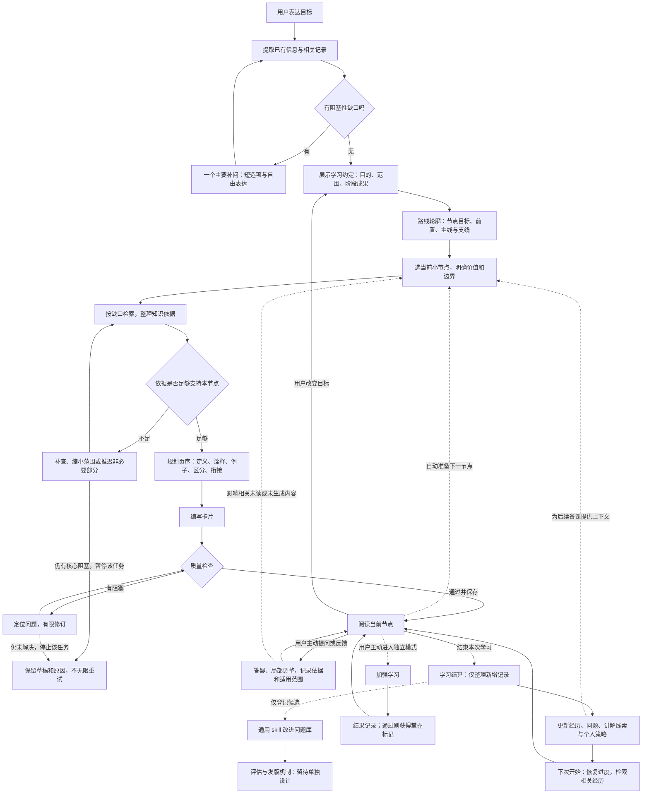

# 知枝：全流程逻辑与决策总览

版本：0.2｜2026-10-23｜MVP 内容逻辑已形成基线；后续已有 Pi 独立最小版，正式业务尚未改造。

**最新补充：用户已接受以准则作为第一版预设，后续针对具体问题修订，不继续穷举所有情形。下文第 5—7 节的问题作为后续细化与验证清单；第 9 节记录本会话最新接受的执行准则。通用 skill 自动升级继续后置，不阻塞 MVP 内容流程。**

更新入口（2026-10-23）：本总览及专项内容已整合进[《知枝-MVP完整策划案》v3.0](/workspace/三创赛知枝/outputs/知枝-MVP完整策划案.md)。以新版记录的 Pi 最小验证进展、已接受准则和落地顺序为准；本文保留阶段总览。已确认指接受设计方向，不表示完整功能或教学效果已验证；参数仍需试用校准。UI 和视觉细节暂缓。

## 1. 全局结论

目前已形成可用于开发验证的主链：

**需求约定 → 路线轮廓 → 有限检索 → 完整小节点生成与检查 → 滚动阅读和备课 → 反馈调整 → 学习结算 → 个人资料与教学策略 → 后续生成。**

另有独立的加强学习分支，以及尚未定案的通用 skill 升级分支。它们不能混入主线变成强制测验或每次对话自动改规则。

架构采用单一学习主 Agent，多份通用流程规则、学科规则与教学方法组合。Pi Agent Core 为优先验证候选；程序保留阶段、存储、版本与校验职责。尚未完成 Pi 安卓接入。

## 2. 主逻辑线路图

图中循环由明确事件触发，不是让 AI 一直反复思考。等待用户输入时结束本次模型运行；阅读翻页不自动启动推理。

图中“足够”是针对当前节点的必要结论、条件、例子与冲突；不表示掌握全部资料。任何有限修订的具体预算仍为工程建议，不能把循环箭头实现成无限请求。

结算发生失败时，原始记录和阅读位置仍应保留；下次先恢复已提交状态，再补做结算。图为主要业务路径，保存失败、版本过时与中断恢复在各写入环节统一处理。

## 3. 三个循环分别优化什么

| 循环 | 锚点 | 触发 | 改动对象 | 结束条件 |
| --- | --- | --- | --- | --- |
| 内容生成循环 | 学习约定、节点目标与依据 | 当前节点缺内容或需要修订 | 材料、页序、卡片 | 满足发布条件；或预算到达后保留阻塞 |
| 个人适配循环 | 实际反馈与学习记录 | 交流中明确反馈；每次学习结算 | 情境偏好、讲解线索、个人策略 | 更新有来源且范围明确；无依据不强行更新 |
| 通用规则循环 | 可复现案例与质量标准 | 阶段性评估 | 正式 skill 版本 | 发版规则尚未决定，不自动采用候选 |

所有循环都必须保留原始目标。旧经历辅助当前教学，不替用户改目的；“没有抱怨”不等于策略有效。

## 4. 已有设计中值得保留的优化

| 优化 | 价值 | 目前边界 |
| --- | --- | --- |
| 核心、条件性、辅助需求分层 | 不用填满问卷才能开始 | 还需真实案例验证补问是否过多或遗漏 |
| 已知、提议、未知分别记录 | 避免把未答基础认定为零基础 | 程序与 schema 尚未实现 |
| 节点目标和完整页序先行 | 防止短卡片碎成无主线的文字 | 需验证跨学科，不强行一套模板 |
| 有限检索与分类处理不确定 | 减少无穷资料和伪确定结论 | 来源判据、检索预算与冲突处理需细化 |
| 当前节点加下一节点储备 | 平衡连续阅读与反馈后的重写成本 | 批量参数暂行，无实际延迟数据 |
| 主线讲述、加强学习独立 | 减少应试压力，保留主动巩固能力 | 加强题目和通过规则未定 |
| 较宽 AI 调整权限与路线知情 | 允许主动补基础和改善编排 | “重大变化”仍需用实例划界 |
| 结算整理、生成前调用记忆 | 可以承接旧概念与例子，不全量灌历史 | 去重、冲突与跨学科相关性需验证 |
| 个人策略与通用规则分开 | 避免个人偏好导致全局 skill 漂移 | 通用 skill 发版明确留待讨论 |

这些是有理由采用的设计，不是已证明的学习收益。

## 5. 当前确认程度

| 环节 | 已确定或接受的方向 | 尚未确定或未验证 |
| --- | --- | --- |
| 需求分析 | 自由表达；每轮一个主要短问题；漏答保留未知；多选保留主次 | 复杂目标的阻塞判据与实际访谈负担 |
| 框架 | 围绕目标，前置清楚，主线与支线可调整 | 节点大小、过宽主题如何缩小、框架何时需重建 |
| 资料 | 按节点缺口检索；核心结论不猜；非必要项可推迟 | 首批材料从哪里来、谁有读取能力、不同学科的依据要求 |
| 生成与检查 | 节点价值、要点、页序、正文、七项检查 | 准确的发布门槛、审查失败退出与修订预算 |
| 批次 | 首个完整小节点启动，持续准备下一节点 | 首批耗时、成本、队列优先级的实测；安卓中断限制 |
| 用户反馈 | 及时局部调整，相关记录影响后续生成 | 怎样区分一次困难、情境偏好与长期要求 |
| 路线调整 | AI 权限较宽；路线变化让用户知情 | 哪些仅通知、哪些需要用户选择、如何撤回 |
| 学习状态 | 浏览点亮；独立加强通过获得掌握标记；无自评掌握 | 通过标准、开放题判定、目标改版后的旧标记 |
| 结算 | 每次活动整理经历、疑问、讲解线索和个人策略 | 会话切分、重复处理、摘要纠错、跨会话合并 |
| 跨树调用 | 有记录且相关时引入旧知识，不假定读过就会 | 检索相关性与引用数量；如何避免牵强联系 |
| 通用 skill | 个人适配不能等于全局升级 | 何时评估、如何判有效、谁决定发布、如何回退 |
| 技术运行 | 单主 Agent，优先验证 Pi Core；业务数据独立 | 安卓适配、完整工具协议、保存和恢复，均非已通过 |

## 6. 最值得认真思考的五个问题

### A. 什么叫“本节点已经讲够、查够、能发布”

这是当前最重要的质量门槛。只有“有来源、模型检查过”还不够，要能列出节点必须说明的结论、条件和易混淆点，并确认资料与卡片分别覆盖。否则既可能无限检索，也可能提早生成。

下一步产出：一个实际节点的“必要要点—依据—卡片位置—未确定项”对照表。缺的是关键结论还是可选拓展，要能明确区分。

### B. 如何让结算有用，而不产生越来越多的错误记忆

结算不能把未解决问题写成已解决，也不能把一次答错或一次例子不懂概括成能力标签。事实记录、助手判断和策略候选需要分开；摘要要能回到原话。

下一步产出：一份结算样例，展示保留哪些、丢弃哪些、与旧记录冲突时怎样处理。不要先建设全量复杂记忆平台。

### C. AI 调整路线的边界怎样做到“主动且可理解”

建议用例子确定权限：换例子、补一页前置解释可以直接做；重排相关节点可做并简短说明；把了解型目标改成考试训练应先给建议，由用户选择。用户拒绝后不能继续暗中执行。

下一步产出：十个左右真实调整案例，分类为直接处理、处理并告知、先建议。数量是建议，不是待用户逐条填写的问卷。

### D. 怎样判断个性化真正改善了内容

记录了偏好，不代表使用正确；用户继续翻页，不代表满意。需要比较同一节点采用策略前后的内容是否更合适、有无遗漏关键条件，并优先使用明确反馈作为证据。

下一步产出：一例局部反馈、一例跨学科调用和一例旧偏好不适用的反例。暂不以留存、时长或提问数量直接等同学习效果。

### E. 运行成本与阅读连续性怎样同时成立

频繁检索、逐卡审查、每次交互都结算，会增加延迟和成本。生成批次需要在等待、重写与内容质量之间取舍；真实运行前不能选出“最优参数”。

下一步产出：当前节点与下一节点的小规模运行记录，统计请求、等待、重写、未解决质量问题。后台执行不能靠流程图保证。

## 7. 哪些现在定，哪些可以后置

| 优先级 | 内容 | 推荐动作 |
| --- | --- | --- |
| 现在深入 | 节点发布门槛、来源不足处理 | 先走一个节点的完整生成过程 |
| 紧接着 | 结算契约、记忆冲突、反馈到生成的映射 | 用刚才模拟整理一份实际样例 |
| 实现前确认 | 路线调整边界、版本与任务失效规则 | 形成案例和统一业务契约 |
| 实现时实测 | 批次大小、请求预算、Pi 与安卓兼容 | 小范围验证，不先大规模迁移 |
| 单独讨论 | 通用 skill 升级与评价 | 当前只记录候选，暂不自动改正式规则 |
| 后置 | UI、美术、知识树画风与动画 | 不影响当前内容逻辑定稿 |

## 8. 文档导航与版本关系

- [需求分析阶段指导](/workspace/三创赛知枝/outputs/知枝-需求分析阶段指导-Pi单Agent.md)：访谈与交接。
- [内容生成与逻辑优化实施指导](/workspace/三创赛知枝/outputs/知枝-内容生成与逻辑优化实施指导.md)：生成、检查、适配与本轮新增的批次和结算结论。
- [卡片阅读与加强学习设计](/workspace/三创赛知枝/outputs/知枝-卡片阅读与加强学习设计.md)：节点完整结构及独立加强学习。
- 《MVP 方案对比与推荐》（历史内容见 Git 标签 pre-integration-20261023）：运行架构比较，Pi 仍需验证。

早期方案和《内部运行逻辑》保留作历史依据。本总览记录本会话截至当前的最新设计选择；和旧文档有差异时以较新的明确选择为准，不把未决建议当成已确认要求。

本轮只整理与同步文档，没有改应用、正式 skill、数据库或 APK，没有执行内容质量试验、自动结算、Pi 接入或真机测试。

## 9. 已接受的第一版执行准则

以下由本会话后续讨论形成并获用户接受。采用准则后进入样例验证，不再把每个工程参数作为产品设计的前置确认；是否启动开发仍按当前策划评审安排处理。

| 问题 | 第一版默认 | 例外和边界 |
| --- | --- | --- |
| 内容发布 | 目标明确，必要内容有依据，例子和条件自洽，前置充分，页间连贯 | 可选拓展缺依据就推迟；核心结论缺依据暂停该部分，不猜测补齐 |
| 学习结算 | 整理经历事实、教学线索、明确反馈和可执行策略，每条能关联原记录 | 没有新信息不强行新增；结算失败保留原始记录并补做，不阻断阅读 |
| 反馈范围 | 一次例子困难先局部处理；学科要求作用于当前树；明确长期要求才长期沿用 | 未明范围先最小合理应用；必要定义、条件和证据不能因偏好省略 |
| 调整权限 | 换例子、拆卡和简短解释直接做；补前置、局部重排和推迟拓展做并告知 | 改目的、明显扩大范围或负担先建议，让用户选择；保留原因和版本 |
| 旧知识调用 | 有真实记录、与当前相关、确实帮助解释时简短引用 | 不自然、不可靠或回忆成本过大就不用；读过不代表已掌握 |
| 个性化评价 | 先检查生成是否采用要求，再寻找明确效果证据 | 翻页、阅读时长、没有投诉不等于有效；无证据记录待观察 |
| 通用 skill | 登记问题、情境、候选改动与验证方式 | 暂不自动改正式规则，升级机制另行讨论 |

后续验证以一个节点的完整生成、一次局部反馈、一次学习结算与一次相关主题承接为主；补资料不足和旧偏好不适用的反例。发布门槛的案例化、结算字段、任务去重及预算属于后续细化与验证工作。

修订以可定位的问题为依据，包括显性程序故障、知识错误、遗漏条件、错误记忆、牵强跨学科引用和用户明确的负担反馈。修复记录触发情境、原因、改动与回归案例，不因为没有报错就认定全部正确。

本次基线确认完成的是设计文档；应用、Pi 集成、正式 skill 改写与端到端验证仍待实施。
